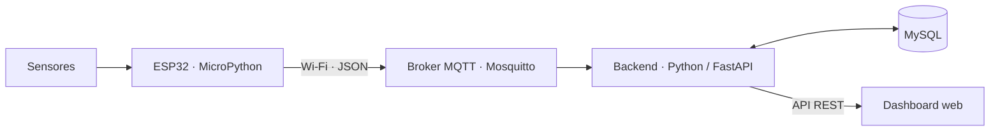
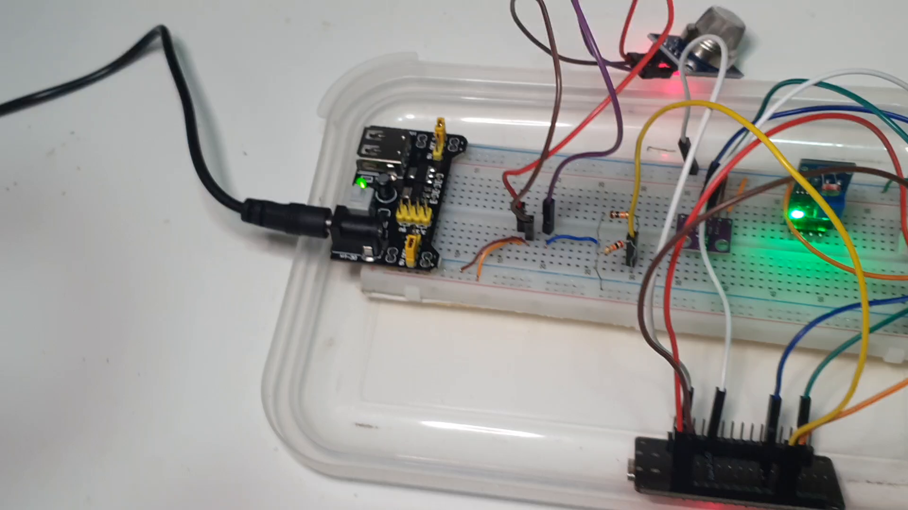

# Estação Meteorológica com ESP32

**[Vídeo de demonstração](https://drive.google.com/file/d/1rDi3x3PGuDIEpWoTzMO3SIER7SXuflYL/view?usp=sharing)**

Projeto integrador de Ciência da Computação da Universidade Paulista (UNIP), desenvolvido na disciplina Projeto e Desenvolvimento II — 68F3, sob orientação do Prof. Marco Gomes.

A estação realiza o monitoramento local de temperatura, umidade, pressão, luminosidade e resposta a gases. A solução integra sensores, comunicação MQTT, processamento em Python, armazenamento relacional e visualização web, permitindo acompanhar as condições ambientais e consultar o histórico de leituras.

## Materiais do projeto

| Material | Acesso |
|---|---|
| Relatório técnico e evidências em vídeo | [Download do PDF completo](https://github.com/ChicooGuk/estacao-meteorologica/releases/download/entrega-2026-11-10/Documentacao_Estacao_Meteorologica_V5_atualizada.pdf) |
| Apresentação executiva | [PDF](docs/apresentacao/apresentacao.pdf) · [PowerPoint](docs/apresentacao/apresentacao.pptx) |
| Montagem no Fritzing e pinagem | [PDF do esquema](docs/esquemas/esquema-eletrico.pdf) · [Projeto editável e imagens](Fritzing/) |
| Registros dos testes | [Procedimentos e resultados CT01–CT04](docs/guias/TESTES.md) |
| Interface web | [Dashboard](https://estacao-metedologica.web.app/) |


*Trecho de um teste funcional com atualização dos indicadores e acionamento de aviso associado à leitura do MQ-135.*

## Arquitetura



O firmware realiza a aquisição a cada 2,5 segundos. O backend valida as mensagens, aplica filtros e registra as leituras no MySQL. O dashboard apresenta indicadores, gráficos históricos, alertas e a localização cadastrada da estação. A recepção de novas leituras depende da operação da placa, do broker e do backend.

## Protótipo



| Sensor | Grandeza | Conexão na ESP32 |
|---|---|---|
| DHT22 | Temperatura e umidade relativa | GPIO4 |
| BMP280 | Pressão atmosférica | SDA: GPIO21; SCL: GPIO22 |
| LDR | Luminosidade estimada | GPIO34 |
| MQ-135 | Resposta a gases e PPM estimado | GPIO35, após divisor de tensão |

As conexões, a alimentação e o condicionamento dos sinais estão descritos no [guia de hardware](docs/guias/HARDWARE.md).

## Instalação e execução

1. Preparar Python, MySQL e Mosquitto conforme o [guia de instalação](docs/guias/INSTALACAO.md).
2. Configurar o ambiente e transferir os arquivos de `firmware/` para a ESP32.
3. Iniciar os serviços e acessar a interface conforme o [guia de operação](docs/guias/OPERACAO.md).

## Organização do repositório

```text
backend/      API, recepção MQTT e filtros
dashboard/    Interface web
database/     Esquema SQL e migrações
firmware/     Programa embarcado e configuração de exemplo
docs/         Apresentação, esquema, guias, imagens e evidências
tests/        Testes automatizados e ensaio de integração
```

## Equipe

| Integrante | RA |
|---|---|
| Francisco Il Guk Fermone Castro de Souza | R330EC8 |
| Lucas Vicente Pereira Silva | R4487J0 |
| Matheus Bifaroni Carvalho | R954838 |

A fundamentação teórica, as referências bibliográficas e a análise dos resultados constam no relatório técnico.
