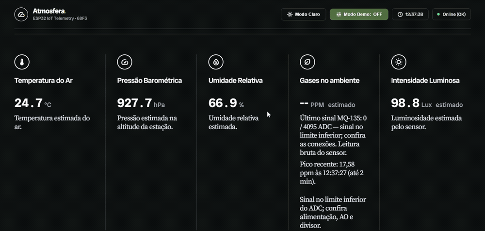
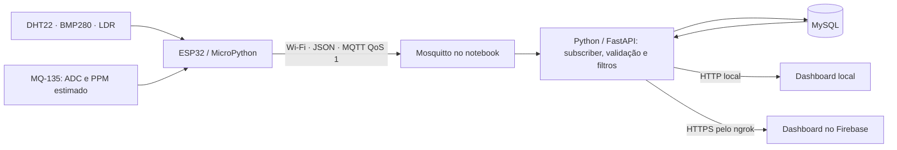
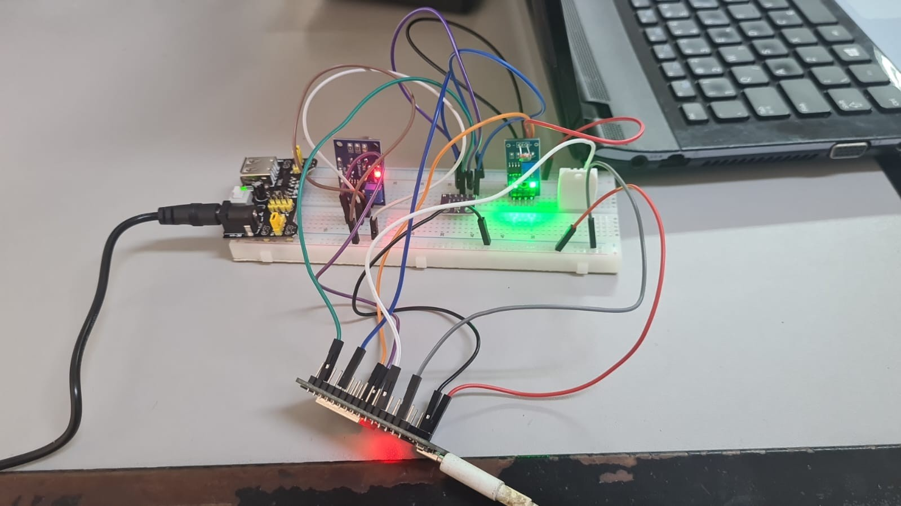
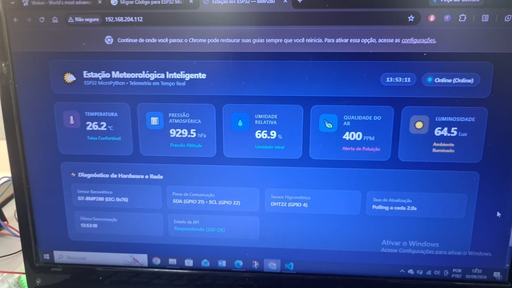

# Estação Meteorológica com ESP32

Projeto integrador de **Ciências da Computação**, disciplina **68F3 — Projeto e Desenvolvimento II**, para monitoramento ambiental no contexto de cidades inteligentes.

**Status:** integração com dados reais em funcionamento, incluindo ADC e PPM estimado do MQ-135. Os testes CT01–CT04 estão documentados; vídeo técnico publicado e apresentação executiva revisada disponíveis.

**Vídeo técnico final:** [assistir à demonstração completa no Google Drive](https://drive.google.com/file/d/1rDi3x3PGuDIEpWoTzMO3SIER7SXuflYL/view?usp=sharing).

**Apresentação executiva:** [PDF revisado](output/apresentacao/revisada/Apresentacao%20Estacao%20Meteorologica%20-%20terceira%20conferencia%20final.pdf) e [PowerPoint editável](output/apresentacao/revisada/Apresentacao%20Estacao%20Meteorologica%20-%20terceira%20conferencia%20final.pptx).

**Dashboard:** [estacao-metedologica.web.app](https://estacao-metedologica.web.app/). A página permanece hospedada no Firebase; novas leituras dependem da placa, da rede e dos serviços ativos no notebook.

### Prévia do sistema em funcionamento



Recorte de 12 segundos de um teste real: atualização dos indicadores e aviso associado à leitura do MQ-135. O valor em PPM é estimado. A demonstração completa está no vídeo vinculado acima.

## Arquitetura atual



O backend e o banco fazem parte do fluxo principal. O dashboard consulta a API Python; não consulta diretamente o IP do ESP32. O servidor HTTP da placa é apenas um diagnóstico opcional, desabilitado por padrão.

A aquisição ocorre a cada **2,5 segundos**, independentemente de haver navegador aberto. A placa mantém uma fila limitada em RAM, configurada para 24 amostras. Após quedas prolongadas, amostras antigas podem ser descartadas; o payload informa esse total. A fila não sobrevive ao desligamento.

O backend valida os campos, identifica duplicatas por estação/boot/sequência, aplica filtro temporal por mediana e desvio absoluto mediano e calcula média móvel de até cinco amostras válidas para temperatura, umidade e pressão. Valores originais e flags de qualidade são preservados no payload armazenado.

## Sensores e limites

| Sensor | Ligação usada pelo firmware | Informação | Situação |
| --- | --- | --- | --- |
| BMP280 | SDA GPIO21, SCL GPIO22; I²C 0x76 ou 0x77 | Temperatura em °C e pressão em hPa | Leituras reais confirmadas |
| DHT22 | GPIO4; pull-up de 10 kΩ (dois de 20 kΩ em paralelo) para 3,3 V | Umidade em % e temperatura principal | Leituras reais confirmadas |
| LDR | ADC GPIO34, circuito em 3,3 V | Luminosidade estimada | Resposta à luz e referência relativa de escuro verificadas |
| MQ-135 | VCC 5 V; AO na GPIO35 pelo divisor de 10/20 kΩ; DO desconectado | ADC bruto, tensão e PPM estimado | Resposta funcional registrada nos testes |

Use GND comum e confira a montagem com o professor antes de alterar conexões. A alimentação de um módulo em 5 V não torna suas saídas compatíveis com os GPIOs da ESP32.

### LDR

A conversão é uma aproximação baseada no circuito e em uma curva de LDR. A configuração privada pode definir `LDR_DARK_REFERENCE_ADC` e `LDR_DARK_MARGIN_ADC`, medidos cobrindo completamente o sensor. Nessa faixa, o firmware informa zero relativo e o estado `escuro_referencia`; o ADC bruto continua registrado.

Esse procedimento **não comprova precisão absoluta em lux**. Comparação com luxímetro e caracterização da montagem continuam pendentes. Não copie uma referência de escuro de outra montagem sem medir novamente.

### MQ-135

Montagem atual: D35, ADC com 0 dB, divisor AO → 10 kΩ → D35 → 20 kΩ → GND e terra comum. DO desconectado; LDR em D34. Alimentação assumida de 4,90 V; RL de 1 kΩ identificado pelo usuário. O divisor deixa dois terços da tensão de AO na entrada; não fornece margem confortável se AO chegar a 5 V. Conferir tensão e tolerâncias antes de qualquer exposição elevada.

O firmware transmite ADC bruto e `mq135_tensao_adc_v` mesmo com ppm desativado. A configuração local prepara uma estimativa equivalente de álcool, com curva publicada, referência ambiental provisória e limites de 10–300 ppm. O exemplo público mantém R0 vazio e a conversão desligada. A configuração precisa ser gravada por USB para produzir efeito; a preparação local não atualiza a ESP32 pelo Wi-Fi.

O card usa PPM estimado e indica <10 ou >300 fora da faixa do modelo, sem extrapolar valores numéricos. Histórico e gráfico preservam null nesses casos. O modelo não identifica gases, não mede concentrações de misturas e não equivale ao AQI regional. Resposta ao álcool ou combustível não valida concentração. A estabilidade do sinal não comprova precisão de ppm.

Veja [modelo de álcool, fontes, cálculo de R0 provisório e hipóteses](docs/estimativa-alcool-mq135.md). As condições ambientais, a alimentação assumida e a marca não confirmada da cápsula limitam a transferência da curva. O temporizador de três minutos não substitui o condicionamento inicial.

O pluviômetro foi retirado do escopo por custo, conforme a dispensa informada pela equipe. Essa exceção deve constar nos materiais finais.

## Estrutura

```text
backend/       API, subscriber MQTT, dependências e modelo de .env
firmware/      boot.py, main.py, mqtt_async.py, bmp280.py e config.example.py
dashboard/     HTML, CSS, JavaScript e configuração do endereço da API
database/      criação das tabelas, migração MQTT e permissão de localização
tests/         testes Python e JavaScript
docs/          documentação V5 e imagens históricas
iniciar_servicos.bat
iniciar_backend.bat
iniciar_ngrok.bat
```

`backend/.env` e `firmware/config.py` são privados. Backups da placa e auxiliares locais também ficam fora do versionamento. Não publique senhas, tokens, perfis Wi-Fi exportados nem ambientes virtuais.

## Preparação do notebook Windows

### Python

O ambiente utilizado neste notebook é Python 3.14, na pasta `.venv314`. Na raiz do projeto, em PowerShell:

```powershell
py -3.14 -m venv .venv314
.\.venv314\Scripts\python.exe -m pip install --upgrade pip
.\.venv314\Scripts\python.exe -m pip install -r backend\requirements.txt
```

Se ainda não existir configuração privada:

```powershell
Copy-Item backend\.env.example backend\.env
```

**Não substitua um `.env` já preenchido.** Configure MySQL, MQTT, `CORS_ORIGINS` e `LOCATION_ADMIN_TOKEN` usando [o modelo](backend/.env.example). Não use os valores de exemplo como credenciais reais.

### MySQL

Instale e configure o MySQL Server. No Workbench, como administrador:

```sql
CREATE DATABASE IF NOT EXISTS estacao_meteorologica CHARACTER SET utf8mb4;
USE estacao_meteorologica;
```

Abra e execute [database/estacao_meteorologica.sql](database/estacao_meteorologica.sql) com esse schema selecionado. Em banco novo, **não execute a migração MQTT**. Para uma estrutura antiga, avalie [database/migracao_mqtt.sql](database/migracao_mqtt.sql) e aplique uma única vez, com backup prévio.

Crie um usuário próprio para a aplicação, escolhendo uma senha privada:

```sql
CREATE USER IF NOT EXISTS 'estacao'@'localhost' IDENTIFIED BY 'ESCOLHA_UMA_SENHA';
GRANT SELECT, INSERT ON estacao_meteorologica.* TO 'estacao'@'localhost';
GRANT UPDATE (latitude, longitude) ON estacao_meteorologica.estacao TO 'estacao'@'localhost';
```

Configure a mesma senha em `DB_PASSWORD` no `.env`. A permissão de localização também está em [database/permissao_localizacao.sql](database/permissao_localizacao.sql).

### Mosquitto e rede

Instale o Mosquitto como serviço. Configure um listener acessível pela rede local, com autenticação e `allow_anonymous false`. O notebook atual usa um arquivo de autenticação em `C:\ProgramData\EstacaoMeteorologica`; ele é local e não acompanha o repositório.

Para outra instalação, gere seu próprio arquivo com `mosquitto_passwd` e aponte `password_file` na configuração do broker. Use as credenciais correspondentes no `.env` e no `config.py` da placa. Permita TCP 1883 no firewall apenas pela interface/rede local necessária.

Notebook e ESP32 devem conseguir se comunicar entre si. Use Wi-Fi de 2,4 GHz compatível com a placa. Alguns hotspots isolam clientes: teste com o celular utilizado na apresentação.

## Configuração e envio à ESP32

Nesta montagem foi identificado MicroPython 1.28.0 em ESP32 genérico. Atualizar arquivos **não exige apagar a flash nem reinstalar o MicroPython**. Faça backup dos arquivos existentes antes de substituí-los.

Copie [firmware/config.example.py](firmware/config.example.py) como `firmware/config.py` e preencha na cópia privada:

| Parâmetro | Uso |
| --- | --- |
| `WIFI_NETWORKS` | Lista em ordem de prioridade: `ssid`, `password` e `mqtt_host` por rede |
| `WIFI_CONNECT_TIMEOUT_MS` | Prazo por tentativa; padrão 15 segundos |
| `WIFI_SSID`, `WIFI_PASS` | Compatibilidade com configuração antiga de uma única rede, quando `WIFI_NETWORKS` não existe |
| `MQTT_HOST` | IP do notebook nessa rede; não `localhost` nem o domínio ngrok |
| `MQTT_PORT`, `MQTT_USER`, `MQTT_PASSWORD` | Acesso ao broker |
| `STATION_ID` | Identificador cadastrado no MySQL; padrão 1 |
| `SAMPLE_INTERVAL_MS` | Intervalo de aquisição; padrão 2500 ms |
| `LDR_DARK_REFERENCE_ADC` | Referência opcional medida na própria montagem |

Envie para a raiz da ESP32 pelo Thonny: `boot.py`, `main.py`, `mqtt_async.py`, `bmp280.py` e `config.py`. **Não copie o dashboard para a placa.** O cliente MQTT está incluído em `mqtt_async.py`.

Alternativa com `mpremote`, a partir da raiz do projeto:

```powershell
.\.venv314\Scripts\python.exe -m pip install mpremote
.\.venv314\Scripts\python.exe -m serial.tools.list_ports
# Substitua COM4 pela porta identificada; feche o Shell do Thonny se estiver usando a porta.
.\.venv314\Scripts\python.exe -m mpremote connect COM4 fs cp firmware/boot.py firmware/main.py firmware/mqtt_async.py firmware/bmp280.py firmware/config.py :
.\.venv314\Scripts\python.exe -m mpremote connect COM4 reset
```

Após reiniciar, o firmware inicia automaticamente. USB pode ser usado para alimentação e logs; a comunicação ocorre por Wi-Fi. As redes de `WIFI_NETWORKS` são tentadas na ordem configurada, sem bloquear a coleta. Se uma não conectar dentro do prazo, tenta a seguinte; se nenhuma conectar, repete o ciclo. Ao perder conexão, recomeça pela primeira. Uma conexão funcionando é mantida, sem troca forçada para outra rede disponível. O broker MQTT acompanha o `mqtt_host` da rede selecionada e reconecta após mudança de conexão. Senhas não são registradas nos logs. Notebook e ESP32 precisam estar na mesma rede acessível; os serviços locais continuam necessários. Se o DHCP alterar o IP do notebook, atualize o perfil correspondente ou configure uma reserva DHCP no roteador.

## Operação diária

1. Conecte o notebook à rede configurada na ESP32.
2. Execute `iniciar_servicos.bat` com autorização administrativa quando necessário e confira MySQL e Mosquitto ativos.
3. Execute `iniciar_backend.bat`; aguarde `Application startup complete` e a conexão MQTT.
4. Execute `iniciar_ngrok.bat` para disponibilizar a API ao dashboard online.
5. Ligue a ESP32 e abra o dashboard.

Os serviços são configurados para iniciar com o Windows. Backend e túnel precisam continuar executando; após reiniciar o notebook, inicie-os novamente. Não abra instâncias duplicadas. O navegador e o Thonny não precisam permanecer abertos para coletar dados.

Comando manual do backend, na raiz:

```powershell
.\.venv314\Scripts\python.exe -m uvicorn python:app --app-dir backend --env-file backend\.env --host 0.0.0.0 --port 8000 --log-level info
```

- Dashboard local: `http://localhost:8000/`
- Documentação da API: `http://localhost:8000/docs`
- Consulta: `GET /api/leituras/ultimas-24h?id_estacao=1`

## Firebase e ngrok

[dashboard/config.js](dashboard/config.js) define o endereço público da API para os domínios Firebase do projeto. [iniciar_ngrok.bat](iniciar_ngrok.bat) usa o mesmo domínio. Em outra instalação/conta, atualize ambos e autorize as origens do dashboard em `CORS_ORIGINS`.

O ngrok encaminha HTTPS ao backend; não hospeda Python, MySQL ou MQTT. O notebook precisa permanecer ligado. A placa publica no IP local do broker, sem passar pelo ngrok.

Para publicar o frontend, com Firebase CLI instalado e conta autorizada:

```powershell
firebase login
firebase deploy --only hosting --project estacao-metedologica
```

O deploy envia somente `dashboard/`, conforme [firebase.json](firebase.json). Mudanças no backend exigem reinício; mudanças no firmware exigem envio à placa.

## Recursos do dashboard

- Gráfico de 24 horas com médias em intervalos de cinco minutos; estatísticas do período calculadas no banco.
- Tabela dos últimos 50 registros da API, paginada em oito registros por tela.
- **Limpar exibição** mantém os registros anteriores ocultos neste navegador, inclusive nas próximas consultas. Novas leituras continuam aparecendo. **Restaurar histórico** reexibe os registros disponíveis. Nenhuma dessas ações apaga dados do MySQL.
- CSV exporta os registros disponíveis na tabela, incluindo suas outras páginas.
- Mapa da posição cadastrada da estação, independente do GPS do visitante. Busca por CEP localiza um ponto aproximado; salvar exige chave administrativa e permissão SQL.
- Comparação Open-Meteo acompanha as coordenadas salvas. AQI na escala dos EUA e concentrações de poluentes são referências externas, separadas da estimativa MQ-135.
- Modo Demo gera dados simulados no navegador e não grava medições no banco.
- Dados antigos deixam de ser tratados como condição atual nos alertas.

A rota `POST /api/leituras` fica desabilitada sem `HTTP_INGEST_TOKEN`. MQTT é a ingestão principal. Tokens administrativos não devem ser incluídos no frontend nem no repositório.

## Testes e validação

```powershell
.\.venv314\Scripts\python.exe -m pip install -r backend\requirements-test.txt
.\.venv314\Scripts\python.exe -m unittest discover -s tests -v
node tests/test_dashboard.cjs
node tests/test_locations.cjs
```

Na validação de desenvolvimento de **21/10/2026**, passaram 23 testes Python e as suítes JavaScript. Foram confirmados recebimento MQTT de leituras reais, persistência no MySQL, API pelo ngrok e resposta do LDR ao cobrir/descobrir o sensor. Isso não substitui testes prolongados nem aferição dos sensores.

Pendências:

- Condicionamento elétrico, ajuste do cálculo e calibração do MQ-135.
- Aferição/avaliação das limitações dos sensores e da precisão da localização no local de instalação.
- Testes sistemáticos de falhas, reconexão, alertas, estabilidade e desempenho, com evidências para CT01–CT04.
- Esquema elétrico e documentação acadêmica atualizados; revisão do acesso ao repositório para avaliação; GIFs, vídeo de 5–7 minutos e slides de 10–12 páginas em PDF.

## Documentação e imagens históricas

A [documentação V5](docs/Documentacao_Estacao_Meteorologica_V5.pdf) foi preservada e descreve etapas da arquitetura anterior. Ela ainda precisa ser atualizada para a integração MQTT.

| Protótipo registrado na V5 | Dashboard da versão anterior |
| --- | --- |
|  |  |

As imagens existentes são registros históricos. Faltam evidências organizadas da versão atual para a entrega.

## Equipe

- Francisco Il Guk Fermone Castro Souza
- Gustavo
- Matheus
- Lucas

Orientação docente registrada no projeto: Prof. Ricardo.


## Correções técnicas de 26/10/2026

Consulte [correções e validação](docs/correcoes-tecnicas.md) para alterações, testes e pendências físicas. Os filtros temporais estão em `backend/filtros.py`. O MQ135 informa diagnóstico elétrico; a estimativa equivalente de álcool foi preparada na configuração local e depende de gravação por USB. Alertas de temperatura/umidade permanecem ativos e variações filtradas do MQ135 geram aviso de verificação, sem classificação universal de concentração crítica.

Revisão de continuidade: [auditoria de comunicação de 02/11/2026](docs/auditoria-comunicacao-2026-11-02.md).
