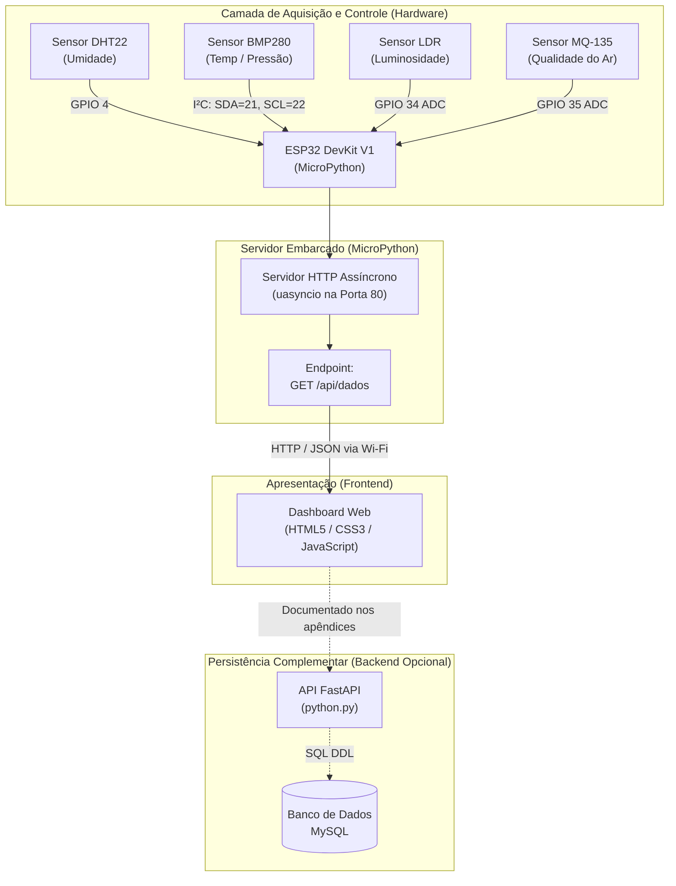
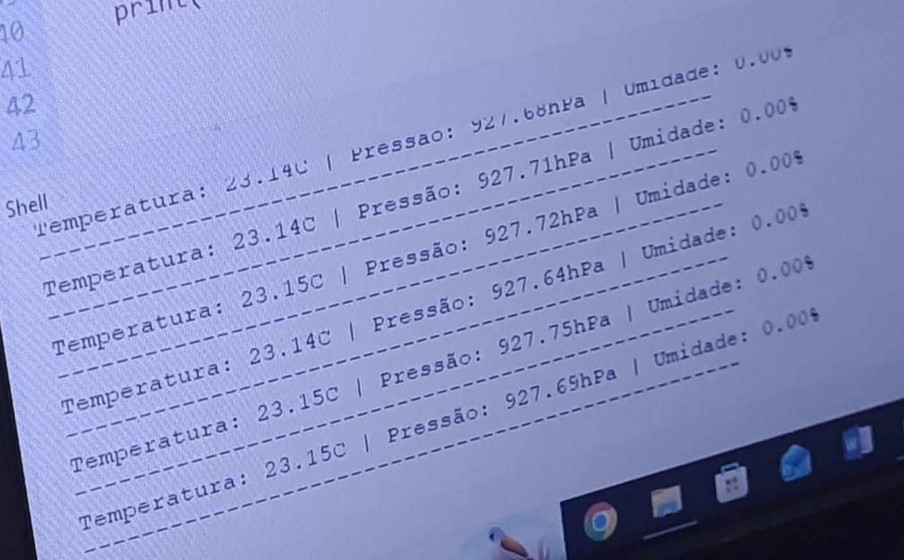
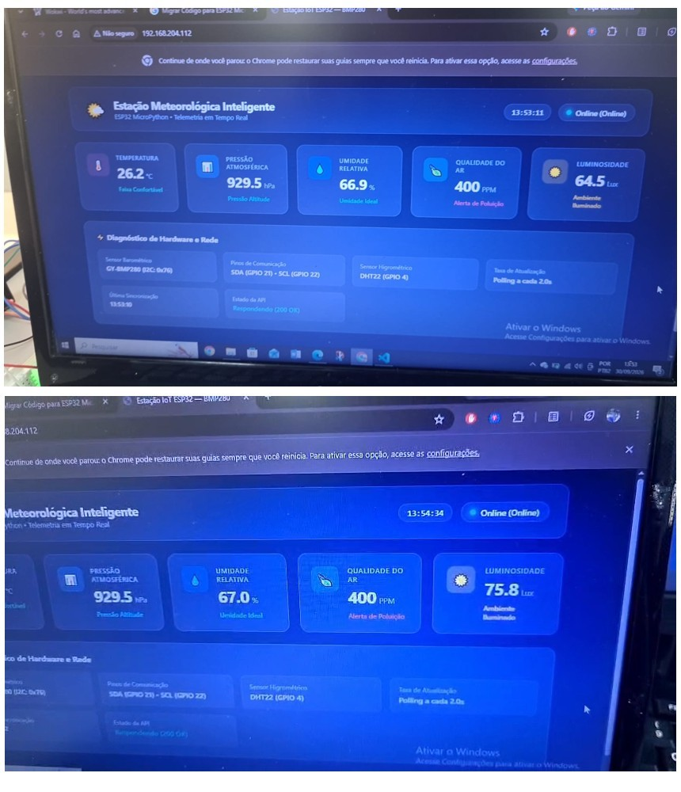

# Estação Meteorológica com ESP32

[](https://micropython.org/)
[](https://www.espressif.com/)
[](./dashboard/)
[](./backend/)
[](./docs/Documentacao_Estacao_Meteorologica_V5.pdf)
[]()

> 📹 **Demonstração em Vídeo:**  
> Assista à demonstração técnica e operacional do projeto no link: **[Vídeo da Estação Meteorológica (<LINK_DO_VIDEO_AQUI>)](<LINK_DO_VIDEO_AQUI>)** *(substitua pelo link publicado do YouTube / Google Drive)*.

---

## 📌 Visão Geral do Projeto

Este repositório reúne os códigos-fonte, esquemas de montagem, scripts de banco de dados e documentação técnica da **Estação Meteorológica baseada no microcontrolador ESP32**, desenvolvida como projeto integrador acadêmico.

O sistema realiza aquisição em tempo real de grandezas meteorológicas e ambientais utilizando sensores de baixo custo, expondo os dados por meio de um servidor HTTP assíncrono embarcado no próprio ESP32 e apresentando-os em um dashboard web responsivo.

### Grandezas Monitoradas:
- 🌡️ **Temperatura Ambiente (°C)** — BMP280 (I²C) / DHT22 (backup).
- 💧 **Umidade Relativa do Ar (%)** — DHT22 (Digital).
- ⏱️ **Pressão Atmosférica (hPa)** — BMP280 (I²C).
- 🍃 **Qualidade do Ar (PPM)** — MQ-135 (ADC Analógico).
- ☀️ **Luminosidade (Lux aproximado)** — LDR (ADC Analógico).

> [!NOTE]
> Conforme registrado na **Documentação Técnica V5**, o sensor pluviométrico (pluviômetro) foi formalmente descontinuado do escopo prático por restrições orçamentárias e de aquisição de componentes, mantendo-se o foco integral na operação confiável dos 4 sensores ambientais citados.

---

## 🏛️ Arquitetura do Sistema

O fluxo demonstrativo principal opera de maneira autônoma na rede local (LAN), onde o ESP32 atua como cliente Wi-Fi e servidor HTTP assíncrono, respondendo diretamente às requisições do frontend:



> [!IMPORTANT]
> **Fluxo Integrado Validado:** A demonstração prática validada pela equipe consiste no consumo direto entre o **Dashboard Web e o ESP32 via HTTP local (`/api/dados`)**. A camada FastAPI/MySQL consta nos apêndices documentais da V5 como artefato complementar de engenharia de software para cenários de persistência histórica em larga escala.

---

## 📂 Estrutura de Diretórios

```text
.
├── backend/
│   ├── python.py                        # API FastAPI com rotas de ingestão e histórico
│   └── requirements.txt                 # Dependências Python (FastAPI, uvicorn, mysql-connector)
├── dashboard/
│   ├── index.html                       # Painel com cards, mapa Leaflet, gráfico Chart.js e alertas
│   ├── style.css                        # Estilos responsivos e tema visual escuro
│   └── app.js                           # Telemetria em tempo real, buffer histórico e geolocalização
├── database/
│   └── estacao_meteorologica.sql        # Script DDL de criação do banco e tabelas MySQL
├── docs/
│   ├── Documentacao_Estacao_Meteorologica_V5.pdf # Documentação técnica completa (63 páginas)
│   └── img/                             # Figuras e evidências originais extraídas da V5
│       ├── figura_1_prototipo.jpg       # Foto do protótipo montado em protoboard
│       ├── figura_2_dashboard.jpg       # Captura do dashboard com telemetria ativa
│       ├── figura_3_teste_bmp280.jpg    # Evidência do teste isolado do BMP280
│       └── figura_4_luminosidade.jpg    # Variação de luminosidade no dashboard
├── firmware/
│   ├── boot.py                          # Script de inicialização e conexão Wi-Fi do ESP32
│   ├── main.py                          # Servidor HTTP assíncrono e leitura dos sensores
│   └── bmp280.py                        # Driver I²C do sensor barométrico BMP280
├── .firebaserc                          # Associação do projeto ao Firebase Hosting
├── firebase.json                        # Regras de deploy do Firebase Hosting
├── .gitignore                           # Exclusão de arquivos sensíveis, caches e dependências
└── README.md                            # Guia completo do projeto
```

---

## 🔌 Pinagem e Conexões do Hardware

| Dispositivo / Sensor | Interface / Pino ESP32 | Tipo de Sinal | Tensão de Operação | Função / Grandeza |
| :--- | :---: | :---: | :---: | :--- |
| **ESP32 DevKit V1** | Micro-USB | Alimentação / UART | 5.0 V (VIN) / 3.3 V | Unidade de Controle e Processamento |
| **BMP280** | **GPIO 21 (SDA)**<br>**GPIO 22 (SCL)** | Digital (I²C, `0x76`) | 3.3 V | Pressão atmosférica (hPa) e Temperatura (°C) |
| **DHT22 (AM2302)** | **GPIO 4** | Digital (1-Wire) | 3.3 V | Umidade relativa do ar (%) |
| **LDR (Fotoresistor)** | **GPIO 34** | Analógico (ADC1_CH6) | 3.3 V (divisor resistivo) | Intensidade de luminosidade (Lux) |
| **MQ-135** | **GPIO 35** | Analógico (ADC1_CH7) | 5.0 V (VCC) / 3.3 V (Aout) | Monitoramento de gases e qualidade do ar (PPM) |

---

## 📸 Galeria de Evidências e Resultados

As imagens abaixo correspondem às evidências técnicas oficiais extraídas diretamente da **Documentação V5 (Relatório Final)**:

| Figura 1 — Protótipo Físico na Protoboard | Figura 2 — Dashboard em Funcionamento |
| :---: | :---: |
|  |  |
| *Montagem na protoboard com ESP32, DHT22, BMP280, LDR e MQ-135.* | *Interface web exibindo temperatura, umidade, pressão, ar e luminosidade.* |

| Figura 3 — Teste de Bancada do BMP280 | Figura 4 — Teste de Variação de Luminosidade |
| :---: | :---: |
|  |  |
| *Leitura do BMP280 validando pressão atmosférica em bancada.* | *Resposta dinâmica do dashboard sob variação luminosa no LDR.* |

> 🎬 **Demonstração em GIF:** *(Caso grave a tela do dashboard em execução, inclua o arquivo `dashboard_demo.gif` na pasta `docs/img/` e referencie-o aqui).*

---

## 🚀 Guia de Instalação e Execução

### 1. Preparação do Firmware (ESP32)

1. **Instalação do MicroPython:**
   Instale a versão mais recente do firmware MicroPython no ESP32 usando o `esptool`:
   ```bash
   esptool.py --chip esp32 --port COM3 erase_flash
   esptool.py --chip esp32 --port COM3 --baud 460800 write_flash -z 0x1000 esp32-20230426-v1.20.0.bin
   ```

2. **Configuração de Wi-Fi:**
   Abra os arquivos `firmware/boot.py` e `firmware/main.py` em uma **cópia local privada** e informe o SSID e a senha da sua rede:
   ```python
   WIFI_SSID = "Nome_Da_Sua_Rede"
   WIFI_PASS = "Sua_Senha_Secreta"
   ```
   > ⚠️ **Atenção:** Nunca comite nem envie senhas reais para repositórios públicos.

3. **Envio dos Arquivos para o ESP32:**
   Utilizando o **Thonny IDE**, **mpremote** ou **ampy**, grave no sistema de arquivos do ESP32:
   - `firmware/boot.py`
   - `firmware/main.py`
   - `firmware/bmp280.py`
   - A pasta `dashboard/` (contendo `index.html`, `style.css` e `app.js`).

4. **Inicialização:**
   Reinicie o ESP32. O console serial exibirá o endereço IP atribuído pelo roteador:
   ```text
   [BOOT] Conectando ao Wi-Fi 'Sua_Rede'...
   [BOOT] Wi-Fi conectado com sucesso!
   [BOOT] Endereço IP atribuído ao ESP32: 192.168.1.150
   [SERVIDOR] Servidor Web HTTP Assíncrono iniciado na porta 80...
   ```

---

### 2. Acesso ao Dashboard

- **Na Rede Local:** Acesse diretamente pelo navegador através do endereço IP do ESP32:
  ```text
  http://<IP_DO_ESP32>/
  ```
- **Ajuste de Conexão no Frontend:** Se executar o dashboard em um servidor local separado (ex: Live Server ou Firebase Hosting), atualize a constante `ESP32_IP` em `dashboard/app.js` com o IP real obtido no boot do microcontrolador.
- **Modo Demonstração Offline:** O dashboard conta com um botão superior `🎮 Modo Demonstração` que gera oscilações realistas dos sensores para validação de layout, gráficos e alertas mesmo sem o ESP32 conectado.
- **Recursos Integrados do Dashboard:**
  - 🗺️ **Mapa Interativo (Leaflet.js):** Ponto geográfico fixo da estação em São Paulo (`-23.55052, -46.63330`).
  - 📈 **Gráfico Temporal (Chart.js):** Histórico contínuo com as últimas leituras de Temperatura, Umidade e Qualidade do Ar.
  - 📊 **Estatísticas da Sessão:** Cálculo automático de Temperatura Máx/Mín, Umidade Média, Pico de Gases e Pressão Média.
  - 🚨 **Banner de Alertas Ambientais (RF04):** Notificação em tempo real para picos de temperatura, ar crítico ou extremos de umidade.

---

### 3. Backend e Banco de Dados (Camada Complementar)

Caso deseje executar a API FastAPI e a persistência no MySQL descritas nos apêndices técnicos:

1. **Criar a Base de Dados:**
   No servidor MySQL, execute o script DDL:
   ```bash
   mysql -u root -p < database/estacao_meteorologica.sql
   ```

2. **Instalar Dependências e Iniciar o Servidor:**
   ```bash
   cd backend
   python -m venv .venv
   # No Windows:
   .venv\Scripts\activate
   # No Linux/Mac:
   # source .venv/bin/activate

   pip install -r requirements.txt
   uvicorn python:app --reload --port 8000
   ```
   A documentação interativa Swagger estará acessível em `http://localhost:8000/docs`.

---

## 📄 Documentação Oficial do Projeto

O documento acadêmico integral revisado e finalizado encontra-se disponível em PDF:
- 📖 **[Documentação Técnica — Estação Meteorológica V5 (PDF)](./docs/Documentacao_Estacao_Meteorologica_V5.pdf)**

---

## 🔒 Segurança e Boas Práticas

- Todos os arquivos deste repositório foram sanitizados e higienizados.
- Não há senhas de redes Wi-Fi, segredos de banco de dados ou tokens de acesso privados versionados.
- O arquivo `.gitignore` está configurado para impedir o envio acidental de arquivos de ambiente (`.env`), bibliotecas (`node_modules/`, `venv/`) e arquivos temporários.

---

## 👥 Equipe e Autoria

Projeto acadêmico desenvolvido para a disciplina de Projetos Integradores de Engenharia:
- **Francisco Il Guk Fermone Castro Souza**
- **Gustavo**
- **Matheus**
- **Lucas**

*Orientação Docente: Prof. Ricardo*
