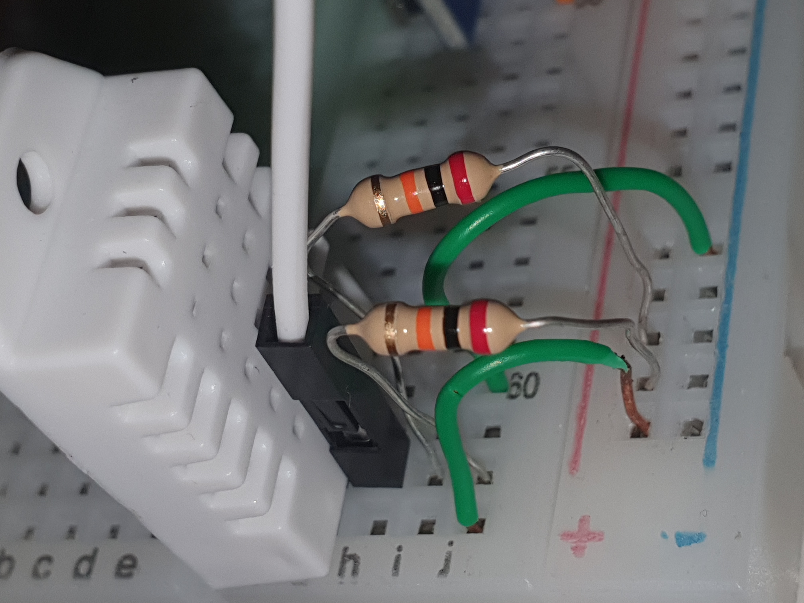
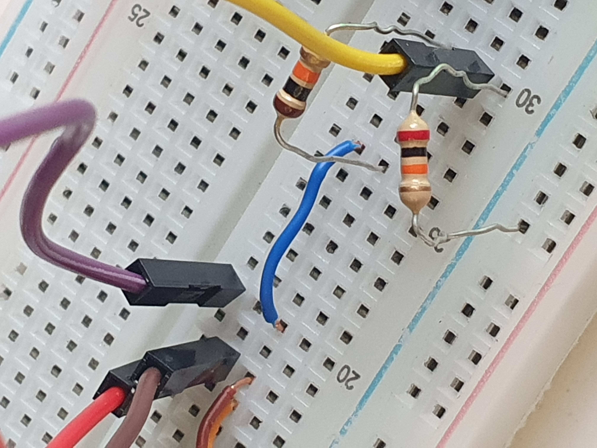

# Hardware e condicionamento dos sinais

O [PDF da montagem no Fritzing e pinagem](../esquemas/esquema-eletrico.pdf) apresenta as conexões externas e a disposição dos pinos da ESP32. O [projeto editável e suas exportações](../../Fritzing/) estão disponíveis para consulta e reprodução. A fonte YwRobot utilizada na figura representa visualmente a HW-131; as identificações de 5 V e 3,3 V indicam a configuração real da montagem.

## Alimentação e pinagem

| Componente | Alimentação | Sinal |
|---|---|---|
| ESP32 | 5 V da HW-131 no VIN | GND comum |
| DHT22 | 3,3 V | DATA na GPIO4 |
| BMP280 | 3,3 V | SDA na GPIO21 e SCL na GPIO22 |
| Módulo LDR | 3,3 V | AO na GPIO34 |
| MQ-135 | 5 V | AO na GPIO35 por divisor de tensão; DO desconectado |

As referências negativas das linhas de 5 V e 3,3 V estão conectadas ao GND da ESP32. O pluviômetro foi retirado do escopo conforme a dispensa registrada nas correções da disciplina.

## DHT22

O pull-up utiliza dois resistores de 20 kΩ em paralelo, equivalentes a 10 kΩ, entre DATA e 3,3 V. O ponto DATA também se conecta à GPIO4.



## MQ-135

O divisor é formado por um resistor de 10 kΩ entre AO e o ponto de leitura, e um resistor de 20 kΩ entre esse ponto e GND:

```text
AO ── 10 kΩ ── ponto de leitura ── 20 kΩ ── GND
                      │
                    GPIO35
```

A tensão na GPIO35 corresponde a `VAO × 20 / (10 + 20)`. O fator de reconstrução de AO é 1,5. O divisor realiza o condicionamento da entrada; o pull-up do DHT22 possui uma função distinta.



| Parâmetro do perfil utilizado | Valor |
|---|---|
| Resolução do ADC | 12 bits, 0 a 4095 |
| Atenuação | 0 dB |
| Leitura de tensão | `read_uv()` |
| Tensão de alimentação adotada no modelo | 4,90 V |
| Resistor de carga do módulo, RL | 1 kΩ |
| Referência virtual da estimativa | 0,045 V |
| Curva equivalente de álcool | `PPM = 77,255 × (Rs/R0)^(-3,18)` |

RL é a resistência de carga do módulo; R0 é o parâmetro de referência do modelo. A configuração de exemplo mantém a conversão desabilitada até o preenchimento dos parâmetros da montagem. O firmware preserva o ADC e a tensão independentemente da apresentação de um valor numérico em PPM.

O resultado em PPM é uma estimativa equivalente do modelo. O MQ-135 responde a diferentes substâncias e não identifica seletivamente o gás presente. Essa grandeza é apresentada separadamente do AQI das fontes externas.

## LDR e BMP280

O módulo LDR utiliza a entrada analógica GPIO34. A luminosidade é apresentada como estimativa, com referência de escuro configurável para a montagem. O BMP280 utiliza I²C; na estação documentada, o endereço identificado é `0x76`. O DHT22 fornece a temperatura principal e o BMP280 pode atuar como fonte de temperatura de reserva.

## Fontes técnicas

- [MicroPython: ADC e ESP32](https://docs.micropython.org/en/latest/esp32/quickref.html).
- [Espressif: conversor analógico-digital](https://docs.espressif.com/projects/esp-idf/en/stable/esp32/api-reference/peripherals/adc.html).
- [Winsen: manual do MQ-135](https://www.winsen-sensor.com/d/files/manual/mq135.pdf).
- [MQSensorsLib: exemplo MQ-135-ALL](https://github.com/miguel5612/MQSensorsLib/blob/master/examples/MQ-135-ALL/MQ-135-ALL.ino).

Fotografias e esquema: acervo da equipe.
